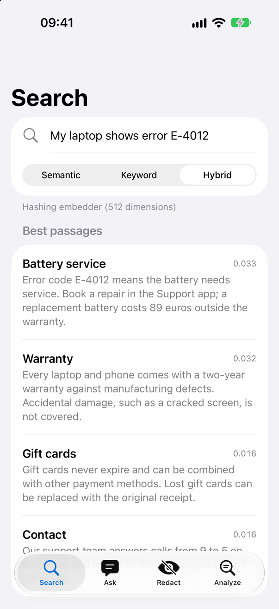
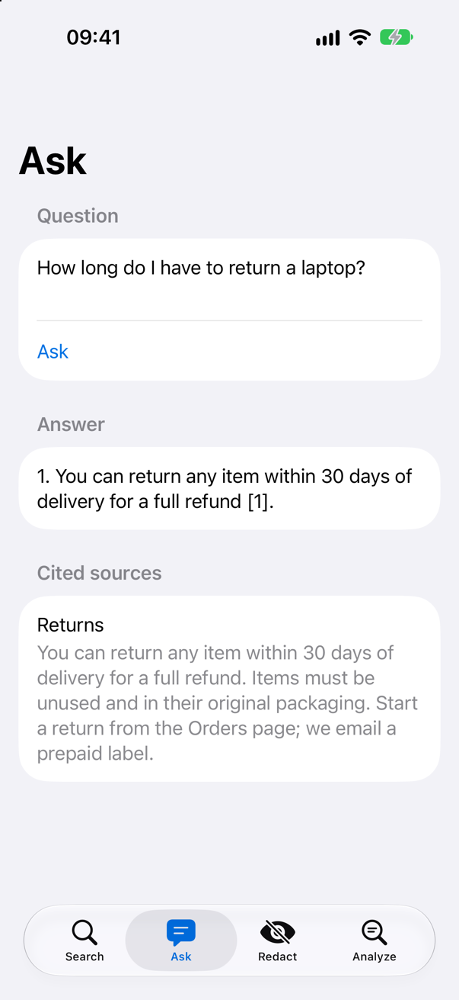
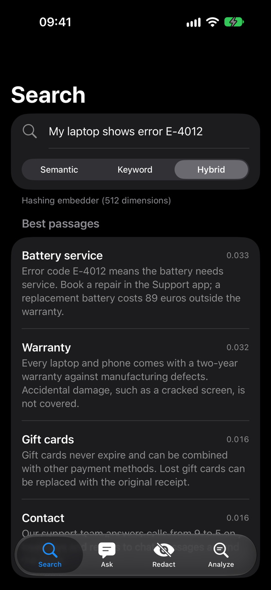
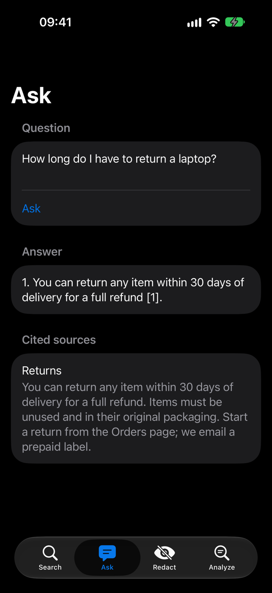
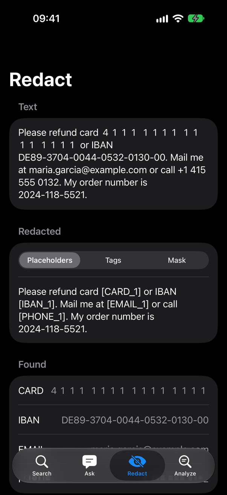

<!-- i18n-source: README.md@c3973900c06dd9a898716cff73ecfa521ffe82e0 status=reviewed -->
<!-- brand:start -->

<p align="center"><picture><source media="(prefers-color-scheme: dark)" srcset="https://raw.githubusercontent.com/muhittincamdali/SwiftIntelligence/main/.github/brand/banner-fr-dark.svg"><source media="(prefers-color-scheme: light)" srcset="https://raw.githubusercontent.com/muhittincamdali/SwiftIntelligence/main/.github/brand/banner-fr-light.svg"></picture></p>

<!-- lang-selector:start -->
<p align="center"><a href="README.md">English</a> · <a href="README.tr.md">Türkçe</a> · <a href="README.zh-CN.md">简体中文</a> · <a href="README.ja.md">日本語</a> · <a href="README.ko.md">한국어</a> · <a href="README.es.md">Español</a> · <a href="README.de.md">Deutsch</a> · <a href="README.fr.md">Français</a> · <a href="README.pt-BR.md">Português (Brasil)</a> · <a href="README.ru.md">Русский</a></p>
<!-- lang-selector:end -->

<p align="center">
<a href="https://github.com/muhittincamdali/SwiftIntelligence/actions/workflows/ci.yml"></a>
<a href="https://github.com/muhittincamdali/SwiftIntelligence/releases"><picture><source media="(prefers-color-scheme: dark)" srcset="https://raw.githubusercontent.com/muhittincamdali/SwiftIntelligence/main/.github/brand/badge-version-dark.svg"><source media="(prefers-color-scheme: light)" srcset="https://raw.githubusercontent.com/muhittincamdali/SwiftIntelligence/main/.github/brand/badge-version-light.svg"></picture></a>
<a href="https://github.com/muhittincamdali/SwiftIntelligence/blob/main/Package.swift"><picture><source media="(prefers-color-scheme: dark)" srcset="https://raw.githubusercontent.com/muhittincamdali/SwiftIntelligence/main/.github/brand/badge-platforms-dark.svg"><source media="(prefers-color-scheme: light)" srcset="https://raw.githubusercontent.com/muhittincamdali/SwiftIntelligence/main/.github/brand/badge-platforms-light.svg"></picture></a>
<a href="https://github.com/muhittincamdali/SwiftIntelligence/blob/main/Package.swift"><picture><source media="(prefers-color-scheme: dark)" srcset="https://raw.githubusercontent.com/muhittincamdali/SwiftIntelligence/main/.github/brand/badge-language-dark.svg"><source media="(prefers-color-scheme: light)" srcset="https://raw.githubusercontent.com/muhittincamdali/SwiftIntelligence/main/.github/brand/badge-language-light.svg"></picture></a>
<a href="https://github.com/muhittincamdali/SwiftIntelligence/blob/main/LICENSE"><picture><source media="(prefers-color-scheme: dark)" srcset="https://raw.githubusercontent.com/muhittincamdali/SwiftIntelligence/main/.github/brand/badge-license-dark.svg"><source media="(prefers-color-scheme: light)" srcset="https://raw.githubusercontent.com/muhittincamdali/SwiftIntelligence/main/.github/brand/badge-license-light.svg"></picture></a>
</p>

<p align="center">
<a href="#démarrage-rapide"><picture><source media="(prefers-color-scheme: dark)" srcset="https://raw.githubusercontent.com/muhittincamdali/SwiftIntelligence/main/.github/brand/button-start-fr-dark.svg"><source media="(prefers-color-scheme: light)" srcset="https://raw.githubusercontent.com/muhittincamdali/SwiftIntelligence/main/.github/brand/button-start-fr-light.svg"></picture></a>
<a href="https://muhittincamdali.github.io/SwiftIntelligence/documentation/swiftintelligence/"><picture><source media="(prefers-color-scheme: dark)" srcset="https://raw.githubusercontent.com/muhittincamdali/SwiftIntelligence/main/.github/brand/button-docs-fr-dark.svg"><source media="(prefers-color-scheme: light)" srcset="https://raw.githubusercontent.com/muhittincamdali/SwiftIntelligence/main/.github/brand/button-docs-fr-light.svg"></picture></a>
<a href="https://github.com/muhittincamdali/SwiftIntelligence/tree/main/Examples"><picture><source media="(prefers-color-scheme: dark)" srcset="https://raw.githubusercontent.com/muhittincamdali/SwiftIntelligence/main/.github/brand/button-examples-fr-dark.svg"><source media="(prefers-color-scheme: light)" srcset="https://raw.githubusercontent.com/muhittincamdali/SwiftIntelligence/main/.github/brand/button-examples-fr-light.svg"></picture></a>
</p>

> Ceci est une traduction du README anglais. En cas de différence, la version anglaise fait foi.

<!-- brand:end -->

Un paquet Swift qui rend le texte de votre app iOS ou macOS consultable et interrogeable sur l’appareil. Ajoutez des notes, des articles d’aide ou des messages à une `KnowledgeBase`, puis cherchez-les par mots et par sens, faites répondre le modèle embarqué d’Apple à des questions à partir de ces textes, avec des citations, et supprimez les adresses e-mail, les numéros de carte et autres données personnelles avant que quoi que ce soit ne soit stocké ou envoyé à un modèle. Il s’appuie sur NaturalLanguage, Accelerate et Foundation Models, n’a aucune dépendance, et rien ne quitte l’appareil à moins que votre app ne l’envoie.

## Points forts

- **Recherche hybride** — chaque passage est indexé deux fois, par ses mots (BM25) et sous forme de vecteur, et les deux classements sont fusionnés par reciprocal rank fusion ; une recherche trouve ainsi aussi bien des codes exacts comme « E-4012 » que des passages qui emploient d’autres mots.
- **Réponses avec sources** — sur iOS 26 et macOS 26, `answer(_:)` demande au modèle embarqué d’Apple de répondre uniquement à partir des meilleurs passages et de les citer ; `groundedPrompt(for:)` construit le même prompt pour n’importe quel autre modèle, et `KnowledgeSearchTool` permet à une session Foundation Models de chercher par elle-même.
- **Masquage réversible** — huit types de données personnelles deviennent des marqueurs tels que `[EMAIL_1]`, auxquels un modèle peut encore se référer, et `restoringOriginals(in:)` remet les valeurs dans sa réponse. Les numéros de carte et les IBAN doivent passer leurs chiffres de contrôle, et les chiffres pleine chasse, les caractères de largeur nulle et les séparateurs inhabituels ne cachent pas une valeur.
- **Trois embedders, ou le vôtre** — un embedder par hachage qui fonctionne partout sans modèle, l’embedding de phrases d’Apple et l’embedding contextuel d’Apple ; adoptez `TextEmbedder` pour brancher un modèle Core ML ou un modèle de serveur.
- **Conservé d’un lancement à l’autre** — `save(to:)` écrit un seul fichier contenant les passages masqués et leurs vecteurs, et le chargement vérifie que l’embedder et les données correspondent.
- **Testé** — 156 tests Swift Testing sur macOS et 155 sur un simulateur d’iPhone, qui couvrent des tentatives de contournement du masquage, des fichiers sauvegardés falsifiés, des entrées NaN ou en dépassement, chaque exemple du README et une réponse du modèle embarqué lorsqu’il est disponible.

## Démarrage rapide

**1. Ajouter le paquet**

Dans Xcode, choisissez **File › Add Package Dependencies…** et saisissez l’URL du dépôt :

```text
https://github.com/muhittincamdali/SwiftIntelligence.git
```

Collez-la dans le champ de recherche en haut à droite de la fenêtre. Laissez **Dependency Rule** sur **Up to Next Major Version** à partir de `2.0.0`, puis cliquez sur **Add Package**. Dans la fenêtre suivante, choisissez la cible de votre app en face de **SwiftIntelligence** et cliquez de nouveau sur **Add Package**.

**2. Importer le module**

```swift
import SwiftIntelligence
```

Placez cette ligne en haut du fichier Swift où vous utilisez le paquet.

**3. L’utiliser**

Dans une nouvelle app Xcode (**File › New › Project… › App**), remplacez tout le contenu de `ContentView.swift` par :

```swift
import SwiftUI
import SwiftIntelligence

struct ContentView: View {
    @State private var answer = "Searching…"

    var body: some View {
        Text(answer)
            .padding()
            .task { answer = await Self.bestMatch() }
    }

    static func bestMatch() async -> String {
        do {
            let knowledge = KnowledgeBase()
            try await knowledge.add("You can return any item within 30 days of delivery for a full refund.", id: "returns")
            try await knowledge.add("Every laptop comes with a two-year warranty against defects.", id: "warranty")
            let results = try await knowledge.search("How do I return an item for a refund?")
            return results.first?.text ?? "Nothing found"
        } catch {
            return "Search failed: \(error)"
        }
    }
}
```

Appuyez sur **Run** (⌘R). L’app cherche dans les deux textes et affiche la meilleure correspondance : « You can return any item within 30 days of delivery for a full refund. »

## Installation

### Swift Package Manager

Dans Xcode, choisissez **File › Add Package Dependencies…** et saisissez l’URL du dépôt :

```text
https://github.com/muhittincamdali/SwiftIntelligence.git
```

Ou ajoutez-le aux `dependencies` de votre `Package.swift` :

```swift
dependencies: [
    .package(url: "https://github.com/muhittincamdali/SwiftIntelligence.git", from: "2.0.0")
],
targets: [
    .target(name: "YourApp", dependencies: [
        .product(name: "SwiftIntelligence", package: "SwiftIntelligence")
    ])
]
```

## Utilisation

Chaque exemple ci-dessous est compilé par l’[app d’exemple](Examples/KnowledgeDemo) et exécuté par les tests du paquet ([`ReadmeSamples.swift`](Examples/KnowledgeDemo/KnowledgeDemo/ReadmeSamples.swift)).

### Rechercher dans vos documents

Ajoutez des documents avec un identifiant et des métadonnées facultatives, puis cherchez dans le mode hybride par défaut, ou uniquement par mots (`.keyword`) ou par sens (`.semantic`) :

```swift
let knowledge = KnowledgeBase()
try await knowledge.add("You can return any item within 30 days of delivery for a full refund.", id: "returns")
try await knowledge.add("Orders ship within two business days; delivery takes three to five days.", id: "shipping")
try await knowledge.add("Every laptop comes with a two-year warranty against defects.", id: "warranty")

let results = try await knowledge.search("How do I return an item for a refund?")
print(results.first?.documentID ?? "nothing found")  // returns
print(results.first?.text ?? "")                     // You can return any item within 30 days …
```

Ajouter un document avec un identifiant existant le remplace, `remove(id:)` le supprime, et `search(_:limit:mode:matching:)` accepte des paires de métadonnées que les résultats doivent avoir.

### Répondre à des questions avec le modèle embarqué

Sur iOS 26 et macOS 26 avec Apple Intelligence activé, le modèle système répond à partir des passages qui correspondent à la question et les cite sous la forme `[1]`, `[2]`, … :

```swift
@available(iOS 26.0, macOS 26.0, *)
func answer(from knowledge: KnowledgeBase) async throws -> GroundedAnswer {
    let answer = try await knowledge.answer("How long do I have to return an item?")
    print(answer.text)                              // for example "Within 30 days of delivery [1]."
    print(answer.citedSources.map(\.documentID))    // ["returns"]
    return answer
}
```

Elle lève `AnswerError.noRelevantPassages` sans interroger le modèle lorsque rien ne correspond, et `AnswerError.modelUnavailable` lorsqu’Apple Intelligence est désactivé ou non pris en charge. Pour un autre modèle, `knowledge.groundedPrompt(for:)` renvoie le prompt et ses sources numérotées.

### Masquer les données personnelles

```swift
let redactor = PersonalDataRedactor()
let redacted = redactor.redact("Mail jane@example.com or pay with 4111 1111 1111 1111.")
print(redacted.text)  // "Mail [EMAIL_1] or pay with [CARD_1]."

// After a model has answered from the redacted text, put the values back.
let reply = redacted.restoringOriginals(in: "I wrote to [EMAIL_1].")
print(reply)          // "I wrote to jane@example.com."
```

Passez un redactor à `KnowledgeBase(redactor:)` et seuls les passages masqués sont indexés et sauvegardés. Le masquage est un filet de sécurité, pas une garantie : les données écrites en toutes lettres (« jane at example dot com ») ne sont pas détectées, et les noms proviennent d’un modèle statistique.

### Rechercher par sens

Le `HashingEmbedder` par défaut fait correspondre les mots et les formes de mots communs. L’embedding de phrases d’Apple fait aussi correspondre des mots apparentés :

```swift
let embedder = try SentenceEmbedder(language: .english)
let knowledge = KnowledgeBase(embedder: embedder)
try await knowledge.add("Our support team answers calls from 9 to 5 on weekdays.", id: "hours")
try await knowledge.add("Every laptop comes with a two-year warranty against defects.", id: "warranty")

// No word in common with the warranty text.
let results = try await knowledge.search("Is my computer covered if it breaks?", mode: .semantic)
print(results.first?.documentID ?? "nothing found")  // warranty
```

Les embeddings d’Apple sont de petits modèles généralistes et le simulateur iOS ne les a pas ; gardez le mode hybride par défaut, sauf si vos propres tests montrent que la recherche sémantique seule convient mieux à vos textes.

### Sauvegarder et restaurer

```swift
try FileManager.default.createDirectory(at: folder, withIntermediateDirectories: true)
let file = folder.appending(path: "knowledge.plist")
try await knowledge.save(to: file)

// On the next launch:
let restored = try KnowledgeBase(contentsOf: file)
```

Restaurez avec le même embedder ; un autre lève `KnowledgeBaseError.embedderMismatch`.

### Analyser du texte

```swift
let analysis = TextAnalyzer().analyze("Tim Cook presented the new iPhone in Cupertino. The audience loved it.")
print(analysis.language?.rawValue ?? "unknown")  // "en"
print(analysis.entities.map(\.text))             // ["Tim Cook", "Cupertino"]
print(analysis.sentiment ?? 0)                   // a positive score
```

## Démo

L’app d’exemple sur un simulateur d’iPhone, qui cherche dans huit articles d’un centre d’aide, y répond et les masque :

| Recherche                                                               | Question                                                            | Masquage                                                               |
| ----------------------------------------------------------------------- | ------------------------------------------------------------------- | ---------------------------------------------------------------------- |
|  |  |  |
|  |  |  |

La réponse affichée sur l’écran de question est la formulation propre du modèle embarqué lors de cette exécution. Les captures sont réalisées à partir de [`Examples/KnowledgeDemo`](Examples/KnowledgeDemo) par [`scripts/capture-example-screens.sh`](scripts/capture-example-screens.sh). Pour lancer l’app, ouvrez `KnowledgeDemo.xcodeproj` dans Xcode, choisissez un simulateur d’iPhone ou **My Mac**, puis appuyez sur **Run** ; [Examples/README.md](Examples/README.md) donne les détails.

## Documentation

Référence de l’API et articles :

- [Référence de l’API](https://muhittincamdali.github.io/SwiftIntelligence/documentation/swiftintelligence/) (DocC, publiée sur GitHub Pages à partir de `main`)
- Générez-la en local dans Xcode avec **Product › Build Documentation**, ou en ligne de commande :

```sh
xcodebuild docbuild -scheme SwiftIntelligence -destination 'generic/platform=iOS'
```

## Guides

- [Getting Started](https://muhittincamdali.github.io/SwiftIntelligence/documentation/swiftintelligence/gettingstarted) — ajouter le paquet, indexer et chercher, sauvegarder d’un lancement à l’autre, analyser un texte ([source](Sources/SwiftIntelligence/SwiftIntelligence.docc/GettingStarted.md)).
- [Searching Documents](https://muhittincamdali.github.io/SwiftIntelligence/documentation/swiftintelligence/searchingdocuments) — modes de recherche, choix d’un embedder, filtres de métadonnées et taille des passages ([source](Sources/SwiftIntelligence/SwiftIntelligence.docc/SearchingDocuments.md)).
- [Answering Questions](https://muhittincamdali.github.io/SwiftIntelligence/documentation/swiftintelligence/answeringquestions) — réponses embarquées, prompts pour d’autres modèles, streaming et outil de recherche ([source](Sources/SwiftIntelligence/SwiftIntelligence.docc/AnsweringQuestions.md)).
- [Redacting Personal Data](https://muhittincamdali.github.io/SwiftIntelligence/documentation/swiftintelligence/redactingpersonaldata) — les huit types, les styles de remplacement, la restauration des valeurs et ce qui n’est pas détecté ([source](Sources/SwiftIntelligence/SwiftIntelligence.docc/RedactingPersonalData.md)).

## Prérequis

| Plateforme | Version minimale |
| --- | --- |
| iOS | 18 |
| macOS | 15 |
| Chaîne d’outils | Swift 6.2 · Xcode 26+ |

Les réponses du modèle embarqué nécessitent iOS 26 ou macOS 26 sur un appareil compatible avec Apple Intelligence, avec Apple Intelligence activé. Le simulateur iOS n’a pas les modèles NaturalLanguage de noms, de sentiment et de catégories grammaticales, ni l’embedding de phrases : `TextAnalyzer` n’y trouve ni noms ni mots-clés, le redactor n’y trouve pas de noms et `SentenceEmbedder` lève une erreur. La CI compile avec le Xcode par défaut de l’image de runner `macos-26` de GitHub ; le paquet est développé avec Xcode 27.

## Architecture

- `Text/` — `TextAnalyzer`, `TextChunker` et la normalisation commune des termes (uniformisation de la casse, des accents et de la chasse ; limites de mots de `NLTokenizer`, si bien que le chinois et le japonais sont découpés en mots).
- `Privacy/` — `PersonalDataRedactor`. Les motifs s’exécutent sur une copie normalisée du texte (`FoldedText`) dont la table de correspondance ramène chaque occurrence aux caractères d’origine ; les chiffres de contrôle (`Checksums`) confirment les cartes et les IBAN ; `NSDataDetector` trouve les numéros de téléphone, les liens et les adresses, et `NLTagger` les noms.
- `Embedding/` — le protocole `TextEmbedder` et ses trois implémentations.
- `Search/` — `VectorIndex` (recherche exacte par cosinus avec une seule multiplication de matrices Accelerate), `KeywordIndex` (BM25), `RankFusion` et l’acteur `KnowledgeBase`, qui les relie et les sauvegarde.
- `Generation/` — `GroundedPrompt`, `GroundedAnswer` et, derrière `canImport(FoundationModels)` et des vérifications de disponibilité, `answer(_:)` et `KnowledgeSearchTool`.

`KnowledgeBase` calcule tous les vecteurs d’un lot avant de modifier quoi que ce soit, de sorte qu’une erreur d’embedding la laisse inchangée. Les index sont exacts et en mémoire : ils conviennent aux documents d’un utilisateur ou d’une app, jusqu’à plusieurs dizaines de milliers de passages.

## Feuille de route

- Du texte issu de PDF et d’images (PDFKit et la reconnaissance de texte de Vision) comme sources de documents.
- Un embedder à encodeur de phrases Core ML, pour une recherche sémantique plus performante que les embeddings intégrés d’Apple.

## Contribuer

Les contributions sont les bienvenues. Lisez le [guide de contribution](https://github.com/muhittincamdali/SwiftIntelligence/blob/main/CONTRIBUTING.md) et le [code de conduite](https://github.com/muhittincamdali/.github/blob/main/CODE_OF_CONDUCT.md) avant d’ouvrir une pull request. Signalez les problèmes de sécurité en privé, comme indiqué dans la [politique de sécurité](https://github.com/muhittincamdali/SwiftIntelligence/blob/main/SECURITY.md).

## Licence

Publié sous licence MIT. Voir [LICENSE](LICENSE).
